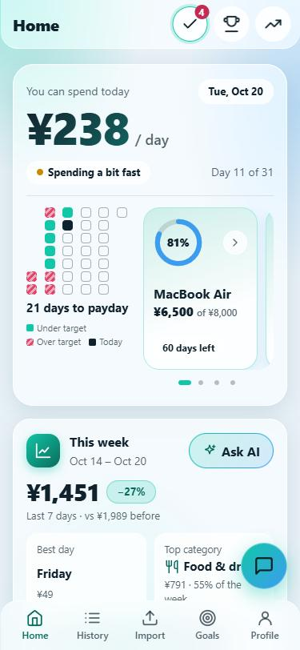
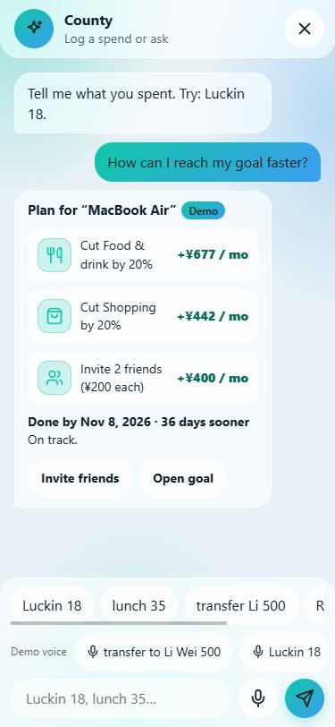
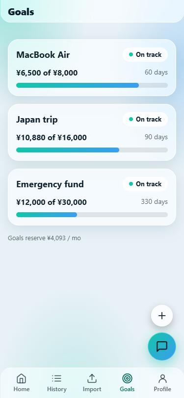
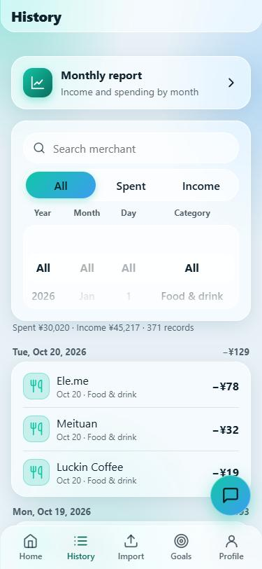
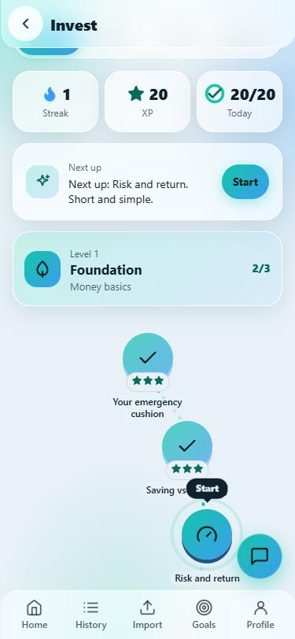
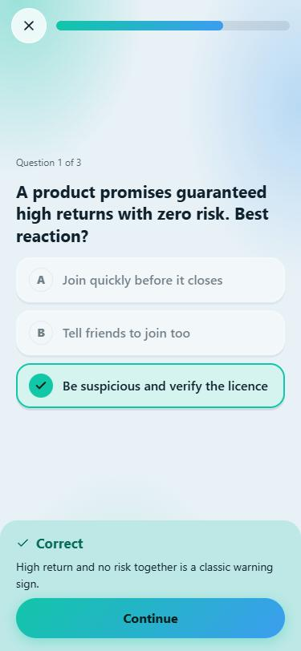
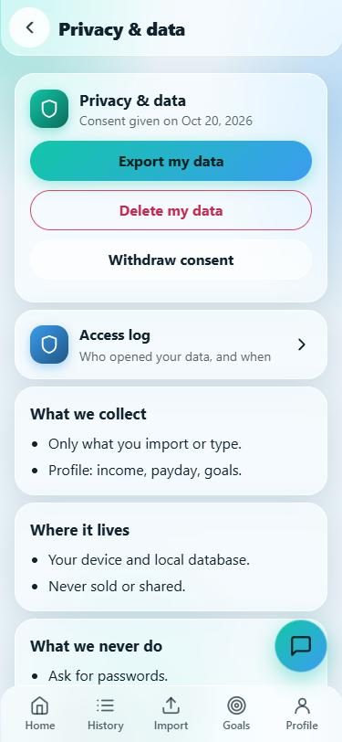

# County

**Budgeting that runs itself.**

County reads a WeChat/Alipay statement or a receipt photo, learns each person's habits and records familiar spending silently. It asks only when something is truly unclear (a new shop, an unusual amount, a transfer to a friend) and always says why. The result is one answer: *you can spend ¥X today before payday.*

Built for the **2026 FinTechathon International Track, Topic A (Personal Finance Assistant)**. Mobile-first web app (PWA), English and Chinese, light and dark themes. **Zero third-party dependencies:** Python 3.12 standard library plus vanilla JavaScript.

> All data in the demo is synthetic. Learning content is educational only and is not investment advice.

**Contents:** [Why](#why-county) · [What it does](#what-it-does) · [Screenshots](#screenshots) · [Quick start](#quick-start) · [How it works](#how-it-works) · [Security](#security-and-privacy) · [Tests and evidence](#tests-and-evidence) · [Real vs simulated](#what-is-real-and-what-is-simulated) · [Project layout](#project-layout) · [API](#api-overview) · [Roadmap](#roadmap) · [Docs](#documentation)

---

## Why County

For many young workers in China, WeChat Pay and Alipay are the bank: money leaves in seconds, but understanding where it went takes effort nobody has. Budgeting apps demand manual entry, so records go stale, trust fades, and the one question that matters, "can I afford this today?", goes unanswered.

County's approach:

- **Quiet by default.** Familiar spending is recorded without a prompt. Only uncertain items interrupt, and every question comes with a reason.
- **Explainable and reversible.** Every automatic decision can be inspected and undone.
- **Money is computed by code, never by a language model.** Allowances, goal dates and savings plans are deterministic and auditable. AI only explains.
- **Accountable by design.** Permission tiers, step-up confirmation, consent, a tamper-evident audit log.

## What it does

| Area | Features |
|---|---|
| **Capture** | Import a WeChat Pay CSV (UTF-8 or GBK), photo of a receipt (demo recognition unless an API key is set), chat input in English or Chinese ("Luckin 18", "转给 浩然 500"), scripted voice demo. Duplicate-safe imports, refunds skipped. |
| **Decide** | Three modes per record: **silent**, **digest** (queued with a reason) or **ask** (needs your answer). Reasons: new shop, unsure category, unusual amount, large amount, money to a person, unclear. A merchant's category is learned after you confirm it once. |
| **Answer** | Home shows "you can spend today" (cents-exact), a day-by-day calendar, status (on pace / spending fast / over budget) and the days to payday. |
| **Goals** | Multiple goals with monthly need and projected finish, swipeable carousel, deposits, a success state, a "what if I add ¥X per week" slider, and a friends "save together" invite. |
| **Insights** | Weekly summary, streaks and badges, "Where to save" with severity and the merchants behind each category, monthly report, history with an iOS-style year/month/day/category wheel. |
| **Ask AI** | A planner that turns your real numbers into a short plan with a new finish date ("cut this 20%, reach the goal N days sooner"). Deterministic today; an LLM can be attached later to phrase it. |
| **Invest** | A Duolingo-style learning path (4 levels, 12 lessons, 36 quiz questions, XP, streak, daily goal, level-up), per-level playbooks, updatable lesson packs (simulated updates), a live news feed from public RSS sources and a curated research reading list. |
| **Trust** | Accounts, guest read-only role, consent gate, privacy screen, data export and delete, access log, accuracy report, Settings. |

## Screenshots

Synthetic demo persona, light theme, 375 px wide.

| Home | Ask AI | Goals | History |
|:---:|:---:|:---:|:---:|
|  |  |  |  |
| "You can spend today", payday calendar, goals | A plan built from real numbers | Progress and status per goal | Search, filters and the date wheel |

| Invest path | Lesson quiz | Privacy and data |
|:---:|:---:|:---:|
|  |  |  |
| Duolingo-style levels, stars, streak, XP | Instant feedback with the reason | Consent, export, delete, access log |

## Quick start

Requirements: Python 3.12 (no `pip install` needed).

```bash
python backend/server.py                 # http://localhost:8000 (localhost only)
python backend/server.py --demo-account  # recording only: creates owner "demo", password printed in the console
python backend/server.py --lan           # phones on the same Wi-Fi (plain HTTP, trusted network only)
python backend/server.py --tls-cert cert.pem --tls-key key.pem   # HTTPS with your own certificate
```

1. Open the printed address. On the first start County asks you to **create an owner account**.
2. Go to **Import** and press **Load demo data**. This loads the synthetic persona *林小雨 (Lin Xiaoyu)*, a 26-year-old designer in Shenzhen: about 370 transactions over 90 days, three goals and friends for the leaderboard. You will be asked for consent first (stored on the server).
3. Try the chat button (bottom right): `Luckin 18`, `转给 浩然 500`, or "How can I reach my goal faster?".
4. Open **Invest > Path** to start a lesson.

Tips: *Settings > Demo tools* has "Reset demo data" and "Try sample receipt". Language and theme (light by default) are in Settings. To start from scratch, stop the server and delete `data/app.db`.

## How it works

```
Browser (PWA, vanilla JS)  ──HTTP/JSON──▶  server.py (stdlib http.server)
   app.js + feature modules                  │  one policy table: PUBLIC / SESSION / READ / OWNER / WRITE / SENSITIVE
   EXT registry for plug-ins                 ├─ auth.py, audit.py   accounts, sessions, lockout, hash-chained log
                                             ├─ service.py          import, chat, confirm/resolve, goals
                                             ├─ rules.py            three-mode policy + merchant memory
                                             ├─ forecast.py         allowance, goals, strip, advice (all money maths)
                                             ├─ advisor.py          "Ask AI" planner (deterministic)
                                             ├─ insights / bench / learn / lessons / news / trust   extension routes
                                             └─ SQLite (data/app.db)
```

**The core decision (rules.py).** A record is `silent` when the merchant is known (confirmed at least twice), confidence is high and the amount is within the merchant's usual range (median ± 3·MAD with a floor). It becomes `ask` for transfers to people, unclear records or amounts far above the user's norm, and `digest` otherwise, always with a reason.

**The daily allowance (forecast.py).** `free = balance − upcoming fixed costs − monthly goal reserve`, `allowance = floor(free / days to payday)`, all in integer cents. Income is detected from the statement (salary rows only); the status compares the allowance with the 14-day average of flexible spending.

**Extensibility.** Frontend features register through an `EXT` object in `frontend/app.js` (routes, blocks on Home/Profile/Settings/Goal/History/Import, post-render hooks). Backend modules expose `register(GET, POST)` and are loaded by `backend/ext_routes.py`.

## Security and privacy

- **Authentication.** Owner account created on first run; passwords stored only as salted PBKDF2-HMAC-SHA256 hashes (600,000 iterations); session in an `HttpOnly`, `SameSite=Strict` cookie with idle and absolute timeouts; brute-force lockout with growing delays; uniform error messages.
- **Permission tiers** (enforced centrally in `server.py`):

| Tier | Who | Examples |
|---|---|---|
| PUBLIC | anyone | static files, auth status, setup, login |
| READ | guest or owner | state, history, reports, news, lessons, Ask AI |
| WRITE | owner (audited) | import, chat, confirm, goals, profile |
| SENSITIVE | owner + password re-entered within 5 minutes (audited) | delete all data, reset demo, export, guest management |

- **Consent.** A PIPL-style consent gate: data-ingestion endpoints answer `428` until consent is recorded on the server. "Withdraw consent" and "Delete my data" are available any time.
- **Audit log.** Append-only, each entry hashed with the previous one; `/api/audit` reports whether the chain is intact, so tampering is detectable.
- **Hardening.** JSON-only POST, Host and Origin checks, CSP and security headers, per-IP rate limit, request size limits, parameterised SQL, escaped output, safe static file serving, no external fonts or CDNs, news fetched only from an allowlist over http(s).
- **Data.** Demo data is synthetic. County never asks for bank or app passwords and never scrapes Alipay or WeChat.

See `docs/submission/02_Security_Self_Assessment.md` for the full tier table, control inventory and the risk register.

## Tests and evidence

```bash
python -m unittest discover -s tests     # 148 tests: money logic, API behaviour, authentication, tiers, lockout, audit chain
python tools/evidence_run.py             # scripted sandbox session on the simulated account, writes evidence/sandbox/
python tools/security_checks.py          # automated security self-test, writes evidence/security/
```

Results recorded in this repository (2026-10-20):

| What | Result |
|---|---|
| Unit and API tests | 148 passed, 0 failed |
| Sandbox session on the simulated account | 30 steps, 163 assertions, 163 passed |
| Security self-test | 347 checks: 325 passed, 0 failed, 22 notes (known limitations) |
| Accuracy report (synthetic labelled set, n = 60) | category accuracy 78.3% overall, 95.1% on known merchants, 0% on unseen merchants at first sight |

Notes on the accuracy report: the set is synthetic and about a third of it uses merchants outside the built-in dictionaries on purpose. The "0.32 taps per record versus 4 manual" comparison uses a modelled manual baseline, not a user study. Evidence files have SHA-256 hashes in `evidence/sandbox/MANIFEST.sha256`.

## What is real and what is simulated

- **Real:** statement import, rules engine and merchant memory, allowance and goal maths, insights and reports, the benchmark, the consent gate, accounts and roles, audit log, export and delete, live news (public RSS), learning progress.
- **Simulated or demo:** the Ask AI planner (no language model), receipt-photo recognition (labelled DEMO unless `ANTHROPIC_API_KEY` is set), friends and leaderboard, bank/Alipay/WeChat connectors (consent flow only, nothing is imported), lesson pack "updates".
- **Known limits:** no encryption at rest; plain HTTP unless you supply a certificate; one dataset per installation (guests see the owner's data read-only); no formal penetration test or legal review of PIPL compliance.

## Project layout

```
backend/     server.py (HTTP + policy), auth.py, audit.py, db.py, service.py, rules.py, forecast.py,
             parse_csv.py, chatparse.py, advisor.py, scan.py, demo.py,
             insights.py, bench.py, learn.py, lessons.py, news.py, trust.py, ext_routes.py
frontend/    index.html, app.js (+ auth.js, trust.js, insights.js, bench.js, invest2.js, learn.js,
             voicedemo.js, merchants_zh.js, content.js), styles.css, manifest.json, icon.svg
data/        bench_set.csv (labelled test set), learn/course.json, lessons/pack_{1,2,3}.json
tests/       test_money.py, test_api.py, test_auth_security.py, helpers.py
tools/       evidence_run.py, security_checks.py
evidence/    sandbox/, security/, tests/  (logs, JSON reports, SHA-256 manifest)
docs/        SPEC.md, DESIGN.md, PRODUCT.md, submission/
```

## API overview

All routes live under `/api` and go through one policy table. Main groups: `auth/*` (setup, login, logout, step-up, guests, password), `state`, `transactions`, `import`, `scan`, `chat`, `confirm`, `resolve`, `goal*`, `profile`, `ask`, `insights`, `report`, `benchmark`, `news`, `lessons*`, `research`, `learn*`, `consent*`, `audit`, `export`, `delete-all`. The complete table with tiers is in `docs/submission/01_Technical_Documentation.md`.

## Roadmap

1. Connect an LLM to phrase the Ask AI plans and read receipts (numbers stay in code; deterministic rules remain the fallback).
2. Real bank and payment-app connections through licensed partners, replacing the simulated consent flow.
3. Encryption at rest (SQLCipher or disk encryption), TLS through a reverse proxy, multi-factor sign-in, per-user data partitioning.
4. Alipay statement format, more merchant coverage, user interviews and a measured accuracy study on real (consented) data.
5. A white-label widget so a bank can embed the allowance and quiet-by-default policy in its own app.

## Documentation

- `docs/submission/00_Submission_Index.md`: project description and index of deliverables
- `docs/submission/01_Technical_Documentation.md`: architecture, algorithms, security design
- `docs/submission/02_Security_Self_Assessment.md`: permission tiers and known-risk list
- `docs/submission/03_Execution_Evidence.md`: sandbox logs and how to reproduce them
- `docs/submission/04_Demo_Video_Script.md`: shot-by-shot script for the demo video
- `docs/SPEC.md`, `docs/DESIGN.md`, `docs/PRODUCT.md`: specification, design system, product notes

## License

No license has been chosen yet. All rights reserved by the authors until one is added.
