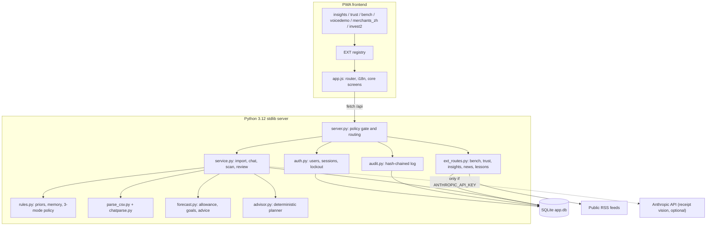
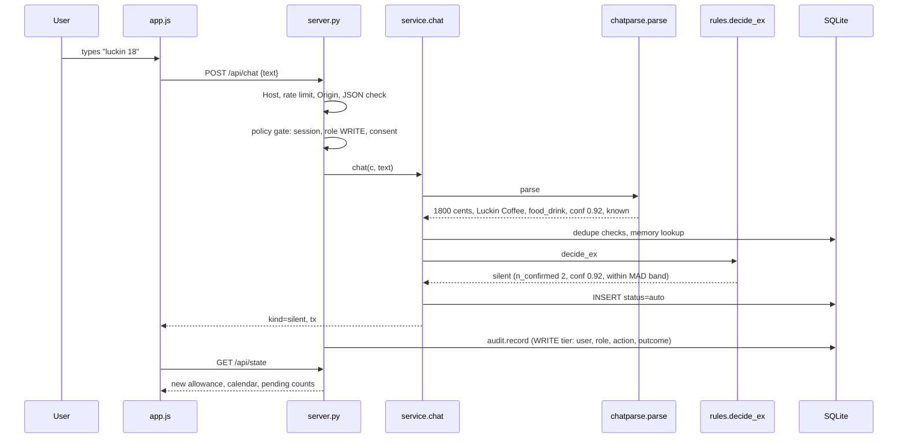
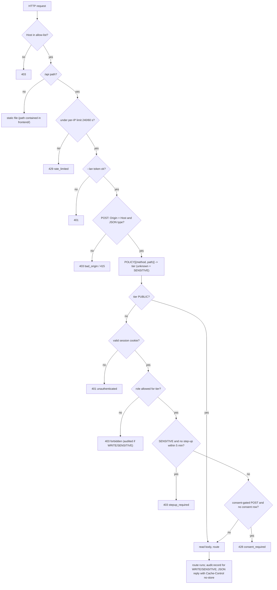

# County: Technical Documentation

2026 FinTechathon International Track, Topic A "Personal Finance Assistant". Document date: 2026-10-20.
All figures below were produced by running the code in this repository on a throwaway database seeded with the synthetic demo persona (see "Reproducing the numbers" in section 7). No real user data is used anywhere.

---

## 1. Overview and problem statement

**Who.** Young salaried people in China who pay through WeChat Pay or Alipay and will not maintain a spreadsheet.

**Problem.** Expense tracking is abandoned because every entry costs effort and returns nothing at the moment of entry. Our hypothesis (not yet user-tested) is that fewer interruptions give more regular tracking.

**What it is.** A mobile-first PWA with a zero-dependency Python backend. The user imports a statement, types or speaks a short note, or scans a receipt. The system remembers merchants, records familiar spending silently, asks only about unclear or important items, and answers one question: how much can I spend per day until payday.

**What makes it different**

| Principle | Implementation |
|---|---|
| Quiet by default | Three-mode policy (silent / digest / ask) with thresholds from the user's own history (`rules.decide_ex`) |
| Explainable | Every record that needs attention carries a `reason` code (new, unsure, unusual, large, person, unclear, income_big); every silent record can be corrected in one tap |
| Money computed by code | All sums, forecasts, goal dates and savings estimates are integer-cent arithmetic in `forecast.py`, `advisor.py`, `insights.py`. No language model is involved in any number |
| Personal memory | `merchant_memory` stores the user's own category per merchant; one answer is enough to stop asking (confirmation weight 2) |

**Topic A mapping**

| Topic A theme | Feature | Code |
|---|---|---|
| Smart budgeting | Daily allowance until payday, free-money formula, day-by-day calendar strip, goal reserve | `forecast.dashboard` |
| Bill / expense analysis | WeChat CSV import with dedupe, auto-categorisation, history filters, monthly report | `parse_csv.py`, `service.import_text`, `insights.report` |
| Spending insights | Weekly summary, streaks, badges, what-if slider, "where to save" with days-faster estimate, Ask-AI plan | `insights.py`, `advisor.py`, `forecast.dashboard` (advice) |
| Beyond the brief | Goals, educational Invest module with live news and updatable lessons, privacy centre | `news.py`, `lessons.py`, `trust.py` |

---

## 2. System architecture

### 2.1 Layers

```
+------------------------------------------------------------------+
| PWA frontend (vanilla JS, no build)  app.js + EXT feature files  |
|  hash router | i18n zh/en | glass CSS tokens | Web Speech voice  |
+-------------------------------+----------------------------------+
                                | JSON over HTTP, or HTTPS with --tls-*
                                | (session cookie; X-Token in --lan)
+-------------------------------v----------------------------------+
| server.py  http.server ThreadingHTTPServer + static files        |
|  Host | rate limit | Origin | JSON-only | POLICY gate (tiers)     |
|  session | role | step-up | consent 428 | audit | headers        |
+---------+---------------------+--------------------+-------------+
          | core routes         | ext_routes.GET/POST registry
+---------v---------+   +-------v--------------------------------+
| service.py        |   | bench | trust | insights | news | lessons|
| import/chat/review|   +-------+--------------------------------+
+--+-----+------+---+           |
   |     |      |               |
+--v--+ +v-----+ +v--------+ +---v-------+   +----------------------+
|rules| |chat- | |forecast | | advisor   |   | external: public RSS |
|.py  | |parse | |.py      | | (no LLM)  |   | (7 allowlisted feeds)|
+--+--+ +------+ +----+----+ +-----------+   | Anthropic API: only  |
   |                  |                       | scan.py, if key set  |
+--v------------------v-----------------------+----------------------+
| SQLite (stdlib sqlite3): data/app.db   data/lessons_state.json     |
|  ledger tables + users, sessions, login_attempts, audit, consent   |
+--------------------------------------------------------------------+
```



### 2.2 Request lifecycle

**Chat "luckin 18"** (verified on the demo database):



**CSV import.** `app.js` reads the file as bytes, decodes UTF-8 strictly (GBK fallback), asks `consentOk()` (PIPL consent dialog in `trust.js`), then `POST /api/import {csv}`; the server independently answers 428 `consent_required` if no consent record exists. `service.import_text` calls `parse_csv.parse`, runs each row through `service.process` (dedupe, memory seeding, `decide_ex`, insert), commits once and returns a report `{read, imported, duplicates, skipped, silent, digest, ask}`. On the demo statement: 371 read, 371 imported, 367 silent, 2 digest, 2 ask.

**Security view of every `/api` request (policy check).** Static files bypass the gate (they hold no data). For `/api/*`:



Verified by `tools/security_checks.py` (checks AUTHN, TIER, STEP, CONS, ORG, RATE) and `tests/test_auth_security.py`.

### 2.3 Deployment

* `python backend/server.py` binds 127.0.0.1:8000 (`PORT` env overrides).
* `python backend/server.py --lan` binds 0.0.0.0, adds the LAN IP to the Host allowlist, generates a random token (`secrets.token_urlsafe(8)`), prints `http://IP:PORT/?t=TOKEN`. The frontend moves the token to `sessionStorage`, strips it from the URL and sends `X-Token` on every `/api/*` call.
* `python backend/server.py --tls-cert CERT.pem --tls-key KEY.pem` serves HTTPS (TLS 1.2 minimum, HSTS header, `Secure` cookie). Both files are required or the server exits; the app does not generate certificates. Without these flags the server speaks plain HTTP, and `--lan` prints a warning that token, cookie and data travel in clear text.
* `python backend/server.py --demo-account` (video recording only) creates an owner `demo`; its password comes from `FC_DEMO_PASSWORD` or is generated and printed once; a "not for production" banner is printed.
* First run: with an empty `users` table the UI shows "Create your account"; the first account becomes the owner. There is no default credential.
* Python 3.12 standard library only; no pip, no Node, no CDN, no web fonts (system font stack with CJK families first).

### 2.4 Data model (SQLite, `db.SCHEMA`)

| Table | Key columns | Notes |
|---|---|---|
| `transactions` | id, date (ISO), amount_cents (int), currency, merchant, merchant_key, category, direction (out/in/transfer), counterparty_type (merchant/person/self), source (chat/csv/screenshot), confidence, status (auto/pending/confirmed), mode (silent/digest/ask), ext_id, raw, reason | Indexes on date and merchant_key. `raw` is the original row truncated to 300 chars |
| `merchant_memory` | merchant_key PK, category, n_confirmed | Median and MAD are not stored; they are recomputed from history on demand (a simplification of docs/SPEC.md section 1) |
| `profile` | id=1, payday_day, income_cents, fixed_json, currency | One dataset per installation (shared read-only with guests). Default fixed cost: rent 3200 yuan on day 1 |
| `goals` | id, name, target_cents, deadline, saved_cents | Multiple goals; their monthly needs add up to the reserve |
| `users` | id, username (unique, case-insensitive), pwd_hash, salt, iterations, role (owner/viewer), created_at, disabled | PBKDF2-HMAC-SHA256, 600 000 iterations, per-user salt; at most 20 users |
| `sessions` | token_hash PK (SHA-256 of the cookie token), user_id, created_at, last_seen, stepup_until, ip | Idle 30 min, absolute 12 h; raw token never stored |
| `login_attempts` | key PK (kind, ip, username), fails, locked_until | Lockout with doubling back-off (60 s to 15 min) |
| `audit` | id, ts, user, role, action, status, ip, prev_hash, hash | Hash chain; no request bodies, passwords or tokens |
| `consent` | id=1, version, at | One global row per installation |

Amounts are integers in cents everywhere in the database. The ledger tables have no user column: there is one dataset per installation. `data/lessons_state.json` holds the installed lesson-pack version.

### 2.5 Module map

| File | Responsibility |
|---|---|
| `backend/server.py` | HTTP server, static files, security headers, `POLICY` table and gate (session, role, step-up, consent), Origin and rate checks, TLS option, route dispatch |
| `backend/auth.py` | Users, PBKDF2 hashing, sessions, step-up, lockout, cookie header |
| `backend/audit.py` | Append-only hash-chained audit log and `verify_chain` |
| `backend/service.py` | Orchestration: process one row, import, chat, scan, confirm, resolve, goals, profile, demo loader, state |
| `backend/rules.py` | Brand priors, `classify`, `norm_key`, `decide_ex`, `learn` |
| `backend/parse_csv.py` | WeChat/generic CSV to normalised rows |
| `backend/chatparse.py` | Rule-based chat extractor (en/zh/ru phrases) |
| `backend/scan.py` | Receipt recognition: Claude vision if key set, labelled DEMO result otherwise |
| `backend/forecast.py` | All budget math: cycle, income, allowance, status, calendar strip, goals, advice |
| `backend/advisor.py` | Deterministic "Ask AI" planner producing structured plans |
| `backend/insights.py` | Weekly summary, streaks, badges, monthly report |
| `backend/bench.py` | Reproducible accuracy benchmark on `data/bench_set.csv` |
| `backend/trust.py` | Data export (portability) |
| `backend/news.py` | RSS ingestion, classification, cache, fallback |
| `backend/lessons.py` | Versioned lesson packs, research reading list |
| `backend/demo.py` | Synthetic WeChat statement generator for persona 林小雨 |
| `backend/ext_routes.py` | Registry that mounts `register(GET, POST)` of extension modules |
| `frontend/app.js` | Router, i18n, core screens, chat sheet, EXT registry |
| `frontend/auth.js` | Sign-in / setup screen, step-up modal, account and guest management, access log, read-only mode for guests |
| `frontend/{insights,trust,bench,voicedemo,merchants_zh,invest2}.js` | Feature plug-ins |
| `tests/` | 148 `unittest` tests (money logic, API, auth and security) |
| `tools/security_checks.py` | 347-check security self-test, writes timestamped evidence |
| `frontend/content.js` | Offline educational content (zh/en) |

### 2.6 Security architecture

Full assessment: `02_Security_Self_Assessment.md`. Summary of what the code implements:

**Authentication (`auth.py`).** First-run setup creates the single owner (`POST /api/auth/setup`, refused once any user exists). Owners can add read-only guests. Passwords: 8 to 256 characters, PBKDF2-HMAC-SHA256 with a random 16-byte salt and 600 000 iterations (stored per row), compared in constant time; a dummy hash runs for unknown users. Sessions: a 256-bit random token in the `fc_session` cookie (`HttpOnly; SameSite=Strict; Path=/`, plus `Secure` under TLS); only its SHA-256 is stored. The token is rotated at login and at step-up. Idle timeout 30 minutes (sliding), absolute lifetime 12 hours. Five consecutive failures per (IP, username) lock that pair for 60 s, doubling per further failure up to 15 minutes; wrong and unknown users return the same 401 body.

**Permission tiers (`server.POLICY`).** One table maps (method, path) to a tier; unknown paths get SENSITIVE.

| Tier | Who | Examples |
|---|---|---|
| PUBLIC | anyone | auth status, setup, login |
| SESSION | any signed-in user | logout, step-up |
| READ | guest or owner | state, transactions, insights, report, benchmark, lessons, research, news, ask |
| OWNER | owner | user list, audit log |
| WRITE | owner, audited | import, scan, chat, confirm, resolve, goals, profile, consent, password change, lessons, news refresh |
| SENSITIVE | owner + step-up (password re-entered within 5 min), audited | delete-all, demo load, export, create or delete guest |

**Step-up.** `POST /api/auth/stepup {password}` re-verifies the owner's password (own lock key), rotates the token and opens a 300 s window (`stepup_until`). The window does not extend the 12 h session lifetime. The frontend shows a password modal when it receives 403 `stepup_required` and retries.

**Audit log (`audit.py`).** Every WRITE and SENSITIVE call is recorded with timestamp, user, role, action, outcome (`ok`, `error:<code>`, `[denied]` suffix on refusals) and client IP, plus logins, failed and locked logins, logouts and step-ups. Each row stores `hash = SHA-256(prev_hash | ts | user | role | action | status | ip)`; `GET /api/audit` (owner only) returns recent entries with `chain_ok` and `first_broken_id`. Plain reads and the audit endpoint itself are not logged. It is tamper-evident, not tamper-proof (no key or external anchor).

**Consent gate.** `POST /api/import`, `/scan`, `/chat`, `/demo` return **HTTP 428** `consent_required` until a row exists in `consent` (written by `POST /api/consent {agree: true, version}`, removed by `POST /api/consent/withdraw` and by delete-all). The consent record is one global row per installation. The client dialog (`trust.js`) is a convenience; the gate is server-side.

**Request hygiene.** Host allow-list, per-IP limit (240 `/api` requests per 60 s), Origin must equal Host on POST, JSON-only POST (415), 9 MB body cap, strict body parsing (non-object or deeply nested JSON gives 400), numeric overflow handled as 400 or a skipped row, year/month/day range validation, `Cache-Control: no-store` on API replies, CSP, nosniff, DENY framing, no-referrer and `Permissions-Policy: camera=(self), microphone=(self), geolocation=()`.

**TLS option.** `--tls-cert` and `--tls-key` wrap the listening socket (TLS 1.2 minimum) and add `Strict-Transport-Security` and the cookie `Secure` flag. Default is plain HTTP on loopback.

**Residual risks** (not implemented): encryption at rest, MFA and account recovery, per-user data partitioning (guests read the owner's dataset), per-user consent, edge rate limiting, automatic certificate handling, a formal penetration test and a PIPL legal review.

---

## 3. Core algorithms

Worked examples use the demo persona on a throwaway database with today = 2026-10-20: salary 15,000 yuan on the 10th, rent 3,200 on the 1st, 371 synthetic WeChat rows over 90 days, three goals.

### 3.1 Three-mode confirmation policy (`rules.decide_ex`)

Constants: `SILENT_MIN_CONFIRMED=2`, `SILENT_MIN_CONF=0.85`, `ASK_MAX_CONF=0.5`, `OUTLIER_MAD_K=3`, `MAD_FLOOR_RATIO=0.15`, `LARGE_INCOME_RATIO=0.2`, `LARGE_CAT_MULT=3`, `CONFIRM_WEIGHT=2`.

```
decide(tx, income):
  if tx.direction == 'in':      ask(income_big) if person and amount >= 0.2*income else silent
  if tx.counterparty == person: ask(person)
  if tx.confidence < 0.5:       ask(unclear)
  if category != housing:
      limit = 0.2*income
      if len(category history) >= 5: limit = max(3*median(category), limit)
      if amount > limit: ask(large)
  if memory[key].n_confirmed >= 2 and tx.confidence >= 0.85:
      if len(merchant history) >= 3:
          tol = 3 * max(MAD, 0.15*median)
          if |amount - median| > tol: digest(unusual)
      silent
  digest(unsure if memory exists else new)
```

Effects (`service.process`): silent gives status `auto`; digest and ask give `pending`. Digest rows are counted in forecasts with a flag; ask rows are excluded until answered (`forecast.COUNTED`).

**Merchant memory and priors.** `rules.BRANDS` (about 40 brand keywords) and `GENERIC` words give a category and confidence 0.92 or 0.9. On first sight of a known brand, `process` seeds `merchant_memory` with `n_confirmed=2`, which is why the demo imports 367 of 371 rows silently. This is a deliberate prior, not learning. For any merchant with memory, the remembered category overrides the row's own, and confidence is raised to at least 0.92 when `n_confirmed >= 2`.

**Learning.** `service.confirm` calls `rules.learn(key, category)`, adding `CONFIRM_WEIGHT=2` to `n_confirmed`, so one user answer makes the merchant silent next time. It also confirms all pending digest rows of the same merchant. Category "other" is never learned.

**Worked example** (demo DB). Luckin history: 64 confirmed purchases, median 1,800 cents, MAD 100, so tolerance = 3 x max(100, 270) = 810 cents.
* "luckin 18": |1800-1800| = 0 gives **silent**.
* "luckin 96": |9600-1800| = 7,800 > 810 gives **digest, reason `unusual`**.
* "tianhe bakery 25": no memory, confidence 0.6 gives **digest, reason `new`**.
* "transfer 300 to Anna": person gives **ask, reason `person`**.
* "laptop 9000 at Foo": 900,000 cents > 0.2 x 1,500,000 = 300,000 gives **ask, reason `large`**.

### 3.2 Statement parsing and normalisation (`parse_csv.parse`)

```
find header row: first cell starts with 交易时间 / date / time   (skips WeChat preamble lines)
map columns by prefix: time, type, party, item, in/out, amount, status, id
for each row:
  cents = Decimal(strip ¥ ￥ , spaces) * 100          (no float; |cents| <= 1e12)
  skip if bad date, cents <= 0, direction not in {支出,收入}, status has 失败, status/type has 退款
  if type in SELF_TYPES (提现, 充值, 信用卡还款, 零钱通): counterparty=self, category=transfers
  else classify(party or item); if type in PERSON_TYPES (转账, 红包): counterparty=person
dedupe (service.process): ext_id seen; or same (date, amount, merchant_key) from another source;
  or csv row without ext_id matching an existing triple
```

Encodings: strict UTF-8 first, then GBK (frontend); UTF-8 BOM stripped. Refund rows marked 退款 are skipped and counted in the report's `skipped`. A refund that arrives as an income row (demo has a 129 yuan Taobao refund) is stored as direction `in`, non-income category: it is not counted as salary, and it is not netted against spend (known limitation). Example: a 4-row test with one failed-direction row and one refund returned 2 imported, 2 skipped; Luckin was categorised food_drink (0.92) and the 500 yuan 转账 to 浩然 became a person transfer, which asks.

### 3.3 Chat extraction and the photo path

`chatparse.parse` (no LLM): the amount regex accepts `¥`, 元/块/yuan/rmb/cny/руб suffixes and thousands separators; it prefers a number with a currency marker, else the last number. Words such as 转给/transfer/红包/перевел mark a person transfer; 工资/salary/зарплата mark income. Remaining text goes to `rules.classify`. Unknown merchant gives confidence 0.6; no merchant text gives 0.5 ("Expense"). Output matches the SPEC section 4 JSON shape. The extractor converts through float once and rounds to cents (CSV uses Decimal).

`scan.analyze`: **without `ANTHROPIC_API_KEY` it returns a fixed, flagged DEMO result (Hema, 46.00 yuan, groceries, confidence 0.7, `demo: true`)**; the UI labels it. With a key it posts the image to the Anthropic Messages API (default model `claude-haiku-5-5`, env `ANTHROPIC_MODEL`), requires strict JSON, validates through `_normalize` (positive cents, fixed category list, date fallback to today) and **caps confidence at 0.8**, so a scanned receipt can never be recorded silently. `service.scan_image` limits images to 5 MB and one scan per 3 seconds. The live API branch exists in code but was not exercised in this verification (no key).

### 3.4 Daily allowance forecast (`forecast.dashboard`)

```
(start, next_payday) = cycle(today, payday_day)         days_left = max(1, next_payday - today)
income   = sum(category='income' rows since start) or profile.income_cents
balance  = income - spent_this_cycle                    (spent: auto, confirmed, pending digest)
upcoming = sum of fixed costs falling on days (today, next_payday)
reserve  = sum over goals of monthly_needed
free     = balance - upcoming - reserve
allowance = max(0, free // days_left)
avg_flex  = flex spend of the last 14 days // 14        (excludes housing, subscriptions, income)
status    = 'over' if free < 0 else 'tight' if avg_flex > allowance else 'ok'
day_target = (profile.income - fixed_total - reserve) // cycle_days
strip[day] = ok | over (spent <= day_target) | today | future
```

Demo numbers (cycle 2026-10-10 to 2026-11-10, 21 days left): income 15,000.00; spent 2,714.00; balance 12,286.00; upcoming rent 3,200.00 (1 Nov); goal reserve 4,093.04; **free = 12,286.00 - 3,200.00 - 4,093.04 = 4,992.96**; **allowance = 499,296 // 21 = 237.76 yuan/day**. Recent flexible spend averages 245.71/day, so status is **tight**. Day target = (15,000 - 3,200 - 4,093.04) / 31 = 248.61. The strip has 5 ok, 5 over, 1 today, 20 future days. The demo loader (`service._calibrate_japan`) deliberately tunes the Japan-trip balance so a +1,000 yuan deposit flips status to ok; this was reproduced (allowance becomes 253.63, status ok). That is scripted demo data, not a product claim.

### 3.5 Goals

```
months_left = max(1, ceil(days_to_deadline / 30))
monthly_needed = ceil((target - saved) / months_left)
projected_saving = profile.income - fixed_total - avg_flex * 30
pace = projected_saving * (goal.monthly_needed / sum monthly_needed)
status = ahead if done or pace >= 1.1*needed; on_track if pace >= needed; else behind
projected_date = today + int(remaining / pace * 30) days
```

Example (MacBook Air): target 8,000, saved 6,500, deadline in 60 days. months_left = 2, needed = 750.00/month. projected_saving = 15,000 - 3,200 - 245.71 x 30 = 4,428.70; share = 750 / 4,093.04 = 0.183, so pace = 811.52/month (below 1.1 x 750), status **on_track**, finish date 2026-12-14 (55 days).

### 3.6 Ask-AI planner (`advisor.py`, deterministic, no LLM)

```
classify(text): goal name or goal words -> 'goal'; saving words -> 'save'; else 'budget'
goal_plan(goal):
  steps = top <=2 advice categories with share >= 0.15 -> cut(monthly = saving/days_left*30)
  gap = needed - pace - sum(cuts); if gap > 0: add weekly step (rounded up to 10 yuan)
  steps += friends(2 x 200 yuan/month)             # mock constant FRIEND_MONTHLY_CENTS
  eta_now = today + remaining/pace*30 ;  eta_new = same with pace + extra
```

Advice inputs come from `forecast.dashboard`: for each top-3 flexible category, `saving = int(0.2 * daily_spend * days_left)` (a 20 percent trim). Example: food_drink spent 1,242.00 in 11 days of the cycle; 20 percent trim over 21 days = 474.21, i.e. 677.44/month; with shopping 442.35 and the friends step 400.00, extra = 1,519.79/month. MacBook Air finish moves from 2026-12-14 to 2026-11-08 (**36 days faster**, still on time). The friends step is a simulated what-if, not a real feature.

**Attaching an LLM later without changing numbers.** The API returns a structured plan (`intent`, `steps`, `eta_now`, `eta_new`); the frontend (`renderPlan`) already words it in zh/en. A model would receive the same JSON and only rephrase it; the numeric fields remain code output and can be shown beside the text and validated (every number in the generated text must appear in the plan). The API does not change.

### 3.7 Insights and accuracy benchmark

**Weekly summary** (`insights._week`): flexible spend of the last 7 days vs the 7 before (delta percent), best day (lowest spend, today skipped while empty), top category and share, and a code-selected tip: `keep` if spend fell, `cut_top` if the top category share is at least 0.35 (suggested monthly cut = 20 percent x 4.3 weeks), else `watch_top`. Demo: 1,590.00 vs 1,989.00, delta -20 percent, top category food_drink at 56.9 percent.

**Streaks and badges.** Consecutive completed days (up to yesterday, window 60 days) with flexible spend at or under `day_target`; demo: current 1, best 4, 33 of 60 days ok. Five badges are threshold rules (7-day streak, 3-day streak, goal complete, 50 auto-recorded entries, top-category share under 35 percent).

**What-if** (frontend, `insights.js`): `new_pace = pace + weekly_extra * 4.3`; finish = today + floor(remaining / new_pace * 30). **Monthly report** (`insights._month`): per-category and top-5 merchant totals, excluding transfers and own-account moves, with delta vs previous month.

**Benchmark** (`bench.compute`): 60 **synthetic** labelled records written for this project (`data/bench_set.csv`: 15 chat phrases, 45 statement rows), replayed in order through the real parser, extractor, memory seeding and `decide_ex` on an in-memory database. When a record is not silent, a simulated user answers with the true category. Manual entry is modelled as 4 taps; ours as 0 / 1 / 2 for silent / digest / ask (a modelling assumption, not a measured user study).

| Metric (n = 60 unless noted) | Result |
|---|---|
| Chat extraction (amount and merchant correct), n = 15 | 100.0 % |
| Category accuracy, all | 78.3 % (47 of 60) |
| Category accuracy, merchants in built-in dictionary (n = 41) | 95.1 % |
| Category accuracy, unseen merchants (n = 19) / first sighting (n = 11) | 42.1 % / **0.0 %** |
| Recorded silently / asked in digest or ask | 75.0 % / 25.0 % (18.3 % digest, 6.7 % ask) |
| Silent with wrong category ("wrong-silent") | 3.3 % of all (2 records), 4.4 % of silent |
| Mode agreement with labelled expectation | 95.0 % |
| Average taps per entry vs 4 manual | 0.32 (92.1 % fewer, under the tap model) |

Honest reading: the set was written by the team and the brand dictionary was written alongside it, so the dictionary-dependent figures are optimistic. The weak spots are real and shown in the app: unseen merchants default to `other` (then go to the digest), and two known-merchant items were mislabelled silently (Meituan movie ticket as food, Pinduoduo fruit as shopping) because merchant memory outranks the item text.

### 3.8 News ingestion and lesson packs

**News** (`news.py`). Seven allowlisted feeds (BBC Business, CNBC, MarketWatch, WSJ Markets, Nasdaq, SCMP, The Guardian); no user-supplied URLs. Fetched server-side in parallel (4 s per feed, 5.5 s overall, 1 MB cap, redirects only to http/https, any document containing a DOCTYPE or ENTITY is rejected before XML parsing). Items are cleaned of markup, deduplicated by normalised title, capped at 12 per source and 60 total, and interleaved across sources. Category by keyword priority china > economy > personal > markets; the "why it matters" key (oil, rates, inflation, yuan, savings, stocks, general) is the first matching word list. Example: "PBOC cuts interest rates as yuan slips" gives category china, key rates. Results are cached 15 minutes (`TTL=900`, lock-protected); `POST /api/news/refresh` forces a refetch. If every feed fails, 12 clearly labelled "Sample feed" headlines with empty URLs are served and the UI says so. Live fetching depends on network access from the host and was not exercised in this verification run.

**Lessons** (`lessons.py`). `data/lessons/pack_N.json` holds topics (each with zh/en text and cited sources) and 10 glossary terms; v1 has 6 topics, v2 8, v3 10, with `new`/`updated` tags from the changelog. `POST /api/lessons/update` advances the installed version stored in `lessons_state.json` (atomic temp-file replace); `reset` returns to v1. **This is a simulated content update** (all packs ship locally); it demonstrates the mechanism a signed remote pack feed would use. The research list holds 18 curated public references (7, 12, 18 visible at v1, v2, v3). Every handler degrades to a safe default instead of raising.

---

## 4. Frontend design

* **Routing.** Hash router (`parse`): `#/home /history /import /goals /profile /review /top /invest[/topic] /goal/{id|new}[/edit] /settings /privacy /benchmark /report`. Own back stack (`navStack`, `goBack`, `syncStack`) with `parentHash` as fallback. `render()` swaps `#app` and moves focus to the page title on navigation.
* **Extension registry (`EXT`).** Feature files register without editing the core: `EXT.routes[name] = {title, page, parent}` adds a screen (or overrides one, as `invest2.js` does for `#/invest`); slot arrays `homeTop, profile, settings, goal, history, importTop, importBottom` inject cards; `EXT.after` runs post-render wiring; `EXT.chatOpen` hooks the chat sheet; `EXT.bankConsent` and the replaceable `consentOk` and `mname` functions override behaviour. Each hook runs in try/catch, so a broken plug-in cannot blank a screen. Mirrored on the server by `ext_routes.py`, which imports each module and tolerates a missing one.
* **i18n.** Central `TXT` dictionary (zh/en); language from `localStorage` or `navigator.language`; `<html lang>` is updated; speech recognition uses zh-CN or en-US; `merchants_zh.js` maps merchant names both ways.
* **Glass design system.** CSS custom properties in `styles.css`: `--glass`, `--gborder`, `--aurora` background, `--accent` (mint) and `--accent2` (blue) as one hue family, `--warn`/`--bad` only for status, radius tokens; backdrop blur with an `@supports` fallback to solid surfaces; light default and a near-black dark theme.
* **Accessibility.** 44 px minimum touch targets; visible `:focus-visible` ring; `aria-label`, `aria-pressed`, `aria-current`, `role=dialog/log/status/alert`; the chat sheet makes the page inert while open and closes on Escape; calendar and charts expose text labels; separate text-colour tokens for contrast; `prefers-reduced-motion` disables animation; no colour-only status (icons and text accompany colour).
* **Offline behaviour.** There is no service worker: the app shell and API need the local server. Degraded modes exist where they matter: Invest falls back to built-in lessons (`content.js`) with an "Offline" notice; news falls back to labelled samples; `localStorage` and `sessionStorage` access is wrapped in try/catch; network failures show retry panels. Voice input needs a browser with the Web Speech API (and HTTPS on phones over LAN).
* **Auth UI (`auth.js`).** A full-screen gate shows "Create your account" on first run and "Sign in" afterwards; a password modal appears on 403 `stepup_required`; the consent dialog on 428. The session is an HttpOnly cookie, so no token or password is kept in `localStorage` or `sessionStorage`. Guests get a read-only banner and write controls are hidden (convenience only; the server enforces roles). Owners get account settings (change password, create and delete guests) and an access-log view with the integrity verdict.
* **No external requests.** CSP `default-src 'self'`, no CDN or fonts (Google Fonts is blocked in mainland China).

---

## 5. Responsible-AI and compliance design

| Concern | Design |
|---|---|
| Numbers | Only code computes money (integer cents). The LLM, where attached, may only extract fields from an image (`scan.py`, schema-validated, confidence capped at 0.8) or, in future, rephrase a code-made plan. No advisor output is produced by a model today |
| Explainability | `reason` codes on every attention item; Ask-AI plans expose the steps and numbers behind each date; benchmark screen lists failures openly |
| Reversibility | Silent records are editable; confirmation and `resolve` change category and learn; "not an expense" purposes (self, repay) reclassify; the user can delete everything |
| No recommendations | Invest content is educational with a "not investment advice" disclaimer and no named products; the news tab shows public headlines with an explanatory tag only; the leaderboard measures percent saved, voluntarily |
| Privacy (PIPL) | Explicit consent before any ingestion, enforced by the server (HTTP 428) with a stored version and time; a privacy page; data minimisation (no bank passwords, no bank scraping, bank connectors are simulated); `GET /api/export` (portability, owner with step-up, audited); `POST /api/delete-all` (erasure of ledger data and the consent record, with VACUUM so deleted rows leave the file). Design-level only: no legal review has been done |
| Data | Only synthetic data ships; demo statement generated per day by `demo.py` |
| Hardening | Accounts with owner and guest roles, salted PBKDF2, HttpOnly SameSite=Strict sessions, lockout, step-up for sensitive actions, hash-chained audit log, Origin check, per-IP limit, optional TLS (section 2.6); Host allowlist, optional LAN token, JSON-only POST (415), 9 MB body cap, parameterised SQL, nosniff / DENY framing / no-referrer / CSP / Permissions-Policy headers, path-traversal check on static files, XML entity rejection |

---

## 6. Testing, limitations and roadmap

**What was tested, and how.**
* **Unit and integration suite: 148 tests, all passing** (`python -m unittest discover -s tests`; about 57 s; output in `evidence/security/unittest_20261020.txt`). `tests/test_money.py` (67): forecast cycle edges, dashboard on the demo persona, allowance and goal reserve, advisor plans, `decide_ex` reasons, merchant memory, CSV and chat parsers, dedupe, benchmark shape. `tests/test_api.py` (28): read endpoints, 415/403/400/413 regressions, bad Content-Length, deep JSON, overflow, path traversal, headers. `tests/test_auth_security.py` (53): setup once, password policy, cookie flags, 401s, lockout, roles, consent gate, step-up and expiry, timeouts, audit chain and tamper detection, secret storage. Each test uses a throw-away SQLite file and its own in-process server on a random port; time-dependent auth tests use an offset clock.
* **Security self-test: 347 checks, 325 PASS, 0 FAIL, 22 NOTE** (`python tools/security_checks.py`; evidence `evidence/security/security_checks_20261020_021541.json` and `.txt`, SHA-256 in the report). It performs setup, consent and step-up as a client, then covers authentication, every policy-table route, tiers, lockout, audit tamper detection, secret storage, Origin, headers, rate limit, a real TLS handshake with a throw-away certificate, and earlier groups (path traversal, SQL injection, scan limits, export, delete-all, news filter). Details and method: `02_Security_Self_Assessment.md` section 6.
* `bench.py` is a reproducible accuracy harness (section 3.7); `GET /api/benchmark` and the `#/benchmark` screen expose it.
* Manual runs of the demo scenario (docs/SPEC.md section 9) and review passes over UI and server hardening. Not covered by automation: real browsers and phones, concurrency and slow-client attacks, a penetration test.

**Known limitations**
* Chat and category intelligence is rule-based; no LLM is connected for chat or advice. Unseen merchants are the main accuracy gap (benchmark: 0 percent on first sighting).
* One dataset per installation: guests share the owner's data read-only and the consent record is global. No encryption at rest (SQLite file in plain form), plain HTTP unless a certificate is supplied, no MFA or account recovery, in-process rate limiting only, no formal penetration test and no PIPL legal review.
* Balance is modelled as income minus spend in the cycle, not a real account balance. Refunds arriving as income are not netted.
* Only the WeChat CSV format is parsed; Alipay format is not implemented.
* Bank connections, friends, leaderboard, "save together" and lesson updates are simulations. `advisor.py` carries a stale comment (150 yuan) beside the 200 yuan friend constant.
* `frontend/manifest.json` still has an older orange theme colour; icon is SVG only (no PNG for iOS).

**Roadmap.** Attach Claude behind a thin `ai.py` for extraction and phrasing, with the rule engine as fallback and number validation; partner-bank data feeds; per-user data partitioning, MFA and encryption at rest (SQLCipher or disk encryption), TLS through a reverse proxy; Alipay format; signed remote lesson packs; PWA service worker and packaging (Capacitor or mini-program shell); running the 148 tests and the security self-test in CI; user interviews to test the "fewer interruptions" hypothesis.

---

## 7. Appendix

### 7.1 API reference

All `/api/*` calls: Host must be localhost/127.0.0.1/[::1] (or the LAN IP in `--lan`); `X-Token` is required in `--lan` mode; POST bodies must be `application/json` and any `Origin` header must equal `Host`; at most 240 requests per minute per client IP. Except the PUBLIC routes, a valid `fc_session` cookie is required (401 `unauthenticated`). Responses are JSON with `Cache-Control: no-store`. Errors: 400, 401, 403 (`forbidden`, `stepup_required`, `bad_origin`), 404, 413, 415, 428 (`consent_required`), 429.

Tier legend: PUBLIC no session; SESSION any signed-in user; READ guest or owner; OWNER owner; WRITE owner, audited; SENSITIVE owner with step-up within 5 min, audited. "Consent" marks routes that return 428 until consent is recorded. Paths not listed get SENSITIVE.

| Method | Path | Tier | Purpose |
|---|---|---|---|
| GET | `/api/auth/status` | PUBLIC | Configured?, signed in?, role, step-up expiry, consent record, idle timeout |
| POST | `/api/auth/setup` | PUBLIC | First-run owner creation `{username, password}`; 409 once any user exists |
| POST | `/api/auth/login` | PUBLIC | Sign in; sets the session cookie; 401 uniform error, 429 `locked` with `retry_after` |
| POST | `/api/auth/logout` | SESSION | End the session |
| POST | `/api/auth/stepup` | SESSION | Re-enter the password `{password}`; opens a 5-minute window and rotates the token |
| POST | `/api/auth/password` | WRITE | Change own password `{old, new}`; other sessions are deleted |
| POST | `/api/auth/viewer` | SENSITIVE | Create a read-only guest `{username, password}` |
| POST | `/api/auth/users/delete` | SENSITIVE | Delete a guest `{username}`; the owner cannot be deleted |
| GET | `/api/auth/users` | OWNER | List accounts (no hashes or tokens) |
| GET | `/api/audit` | OWNER | Recent audit entries (`limit` up to 500) with `chain_ok` and `first_broken_id` |
| POST | `/api/consent` | WRITE | Record consent `{agree: true, version}` |
| POST | `/api/consent/withdraw` | WRITE | Remove the consent record |
| GET | `/api/state` | READ | Dashboard: allowance, strip, goals, advice, pending list, leaderboard (demo) |
| GET | `/api/transactions` | READ | History with filters `year (1900-2200), month (1-12), day (1-31), category, direction, q` (max 400 rows; out-of-range values give 400) |
| GET | `/api/insights` | READ | Weekly summary, streaks, badges, goal pace |
| GET | `/api/report` | READ | Monthly report (`year`, `month`) |
| GET | `/api/benchmark` | READ | Accuracy benchmark on synthetic set |
| GET | `/api/news` | READ | Cached news (`cat`: all, markets, economy, china, personal) |
| GET | `/api/lessons` | READ | Installed lesson pack, tags, changelog, term of the day |
| GET | `/api/research` | READ | Reading list for installed version |
| POST | `/api/ask` | READ | Structured plan `{kind: goal, save, budget, text; id?, text?}` |
| GET | `/api/export` | SENSITIVE | Full data export (profile, goals, transactions, memory) |
| POST | `/api/demo` | SENSITIVE, consent | Wipe and load the synthetic persona |
| POST | `/api/delete-all` | SENSITIVE | Erase all ledger data and the consent record (accounts and audit log are kept) |
| POST | `/api/import` | WRITE, consent | Import CSV text `{csv}` |
| POST | `/api/chat` | WRITE, consent | Parse and record a note `{text}` (300 chars max) |
| POST | `/api/scan` | WRITE, consent | Receipt image `{image, media_type}` (DEMO unless key set) |
| POST | `/api/confirm` | WRITE | Set category and learn `{id, category}` |
| POST | `/api/resolve` | WRITE | Answer an ask `{id, purpose}` (purchase, gift, loan, split, self, income, repay) |
| POST | `/api/goal`, `/api/goal/delete`, `/api/goal/deposit` | WRITE | Create or edit, delete, deposit to a goal |
| POST | `/api/profile` | WRITE | Payday and monthly income |
| POST | `/api/news/refresh` | WRITE | Force news refetch |
| POST | `/api/lessons/update`, `/api/lessons/reset` | WRITE | Simulated pack update, reset to v1 |

### 7.2 Configuration

| Item | Default | Effect |
|---|---|---|
| `PORT` | 8000 | Listening port |
| `--lan` | off | Bind all interfaces, require token, allow LAN host (plain HTTP unless TLS flags are also given) |
| `--tls-cert FILE --tls-key FILE` | off | Serve HTTPS (TLS 1.2+), add HSTS and the cookie `Secure` flag; both required; owner supplies the certificate |
| `--demo-account` | off | Recording only: create owner `demo`; password from `FC_DEMO_PASSWORD` or generated and printed once |
| `FC_DEMO_PASSWORD` | unset | Password for `--demo-account` |
| `ANTHROPIC_API_KEY` | unset | Enables real receipt vision; unset gives the labelled DEMO result |
| `ANTHROPIC_MODEL` | `claude-haiku-5-5` | Model used by `scan.py` |
| `data/app.db` | auto-created | SQLite store with ledger, accounts, sessions, audit and consent (delete to reset everything, including the owner account) |

Reproducing the numbers: from `backend/`, point `db.PATH` at a temporary file, call `service.load_demo(c)`, then `forecast.dashboard(c, date.today())` and `bench.compute()`. Run without `python -I`.

### 7.3 Glossary

| Term | Meaning |
|---|---|
| Allowance | Free money divided by days until payday, floored, never negative |
| Free money | Balance minus upcoming fixed costs minus goal reserve |
| Flex spend | Spending excluding housing, subscriptions and income |
| Silent / digest / ask | Record automatically / queue for later check / ask now |
| MAD | Median absolute deviation, robust spread used to flag unusual amounts |
| Reserve | Sum of monthly contributions needed by all goals |
| PIPL | China's Personal Information Protection Law |
| EXT | Frontend extension registry |

### 7.4 Real versus simulated

| Capability | Status | Evidence |
|---|---|---|
| Rules, merchant memory, three-mode policy | Real | `rules.py`, `service.process` |
| Forecast, allowance, goals, advice arithmetic | Real | `forecast.py` |
| CSV import (WeChat format), dedupe | Real | `parse_csv.py`; input is synthetic |
| Chat extraction | Real, rule-based (no LLM) | `chatparse.py` |
| Receipt scan | **Demo result unless API key set**; API path implemented, untested here | `scan.py` |
| Ask-AI planner | Real arithmetic, **no LLM**; friends step is a mock constant | `advisor.py` |
| Insights, streaks, what-if, report | Real | `insights.py`, `insights.js` |
| Accuracy benchmark | Real code on a **synthetic** 60-record set | `bench.py` |
| News feed | Real RSS fetch with cache; labelled samples when offline | `news.py` |
| Lesson packs "updates" | **Simulated** versions from local files | `lessons.py` |
| Consent gate (server-side 428), export, delete | Real | `server.py`, `trust.js`, `trust.py`, `db.wipe` |
| Accounts, owner and guest roles, sessions, lockout, step-up | Real | `auth.py`, `server.POLICY` |
| Audit log with hash chain and integrity check | Real (tamper-evident only) | `audit.py` |
| TLS | Real when `--tls-cert/--tls-key` are supplied; default is plain HTTP; tested with a throw-away certificate | `server._tls_context` |
| Friends and leaderboard | **Demo data** | `service.FRIENDS` |
| Bank connectors | **Simulated** (no bank data) | `trust.js` |
| User data | **Synthetic** persona only | `demo.py` |
| Encryption at rest, MFA, per-user data partitioning | **Not implemented** | `db.py` (no user column on ledger tables) |
| Penetration test, PIPL legal review, certifications | **Not done** | `02_Security_Self_Assessment.md` section 8 |
